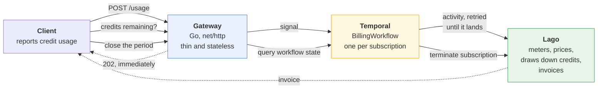
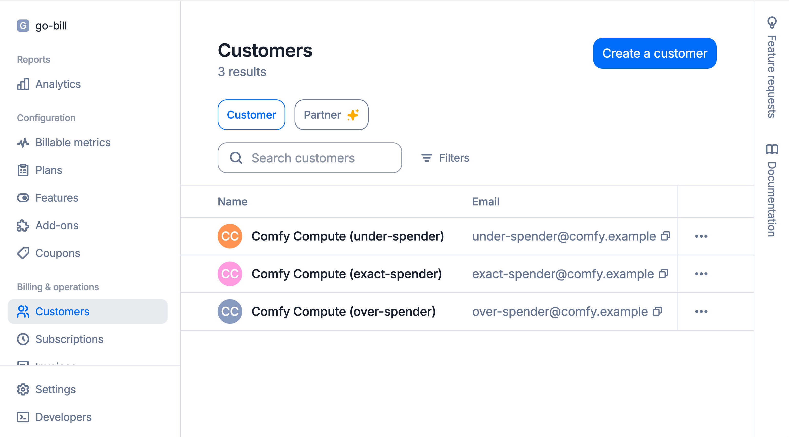
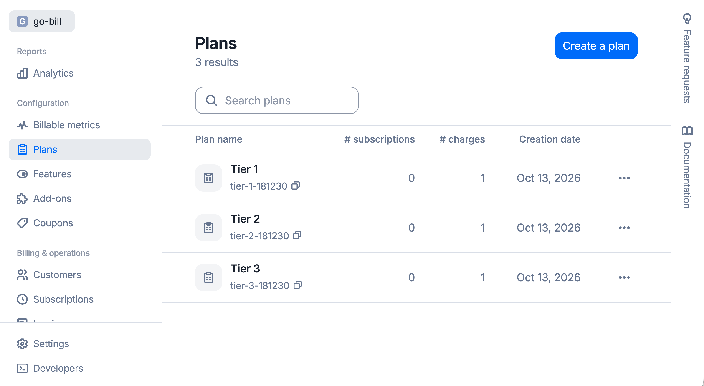
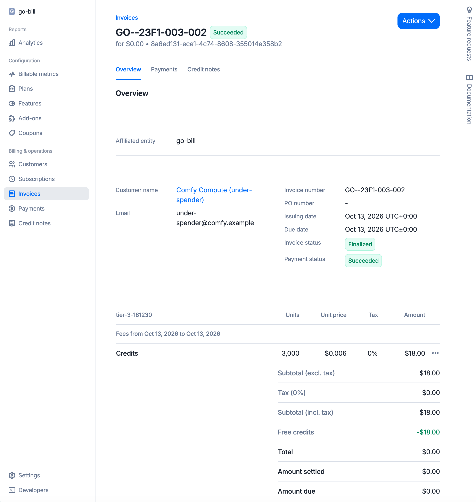

# go-bill

A small, working demo / learning project for a **credit-based billing** system - the model where a customer buys a monthly
tier that bundles compute credits, and usage draws those credits down.

It is built from three pieces that each do one job:

- **[Go](http://go.dev)** for the service code: an HTTP gateway, a worker, and a client.
- **[Temporal](https://temporal.io)** for orchestration: durable delivery of usage, the live
  credit balance, and the billing-period lifecycle.
- **[Lago](https://github.com/getlago/lago)** for metering and billing: meters, plans,
  prepaid credit wallets and invoices.

Lago stands in for **[Metronome](https://metronome.com)** here. Metronome is the commercial
usage-based billing platform this shape of system is usually built on; Lago is open source
and self-hostable, so the whole thing runs in Docker on a laptop with no accounts to sign up
for. The concepts map closely: metric, plan, charge, subscription, usage event, invoice.

Nothing here needs a cloud account. `docker compose up` and `go test` are the whole setup.

## The pieces

| Package | What it is |
| --- | --- |
| `lago/` | Self-hosted Lago in Docker, plus the credit-tier billing configuration and the arithmetic behind it |
| `demo/` | The system: an HTTP gateway, a Temporal workflow per subscription, and a client that drives it |
| `temporal/` | A containerized Temporal dev server and a minimal workflow, as a standalone starting point |
| `mock-h/` | **Bonus.** A tiny HTTP mocking library, used here to impersonate Lago in fast tests |

## How it fits together



The gateway never talks to Lago. It hands usage to Temporal and answers `202` straight away,
so it stays fast and stays up even while Lago is restarting. Temporal then guarantees
delivery, with a stable transaction id making every retry safe to repeat.

## The billing model

Three tiers. A customer picks one.

| Tier | Monthly fee | Credits included | Rate per credit |
| --- | --- | --- | --- |
| `tier-1` | $20.00 | 2000 | $0.0100 |
| `tier-2` | $40.00 | 5000 | $0.0080 |
| `tier-3` | $60.00 | 10000 | $0.0060 |

The monthly fee equals credits x rate, so a tier's allowance is worth exactly what the tier
costs. Usage inside the allowance is absorbed by the credits and you pay just the fee; usage
past it is billed at your tier's rate.

| Credits used on `tier-1` | Tier invoice | Usage | Paid by credits | To pay | Total |
| --- | --- | --- | --- | --- | --- |
| 1500 of 2000 | $20.00 | $15.00 | $15.00 | $0.00 | **$20.00** |
| 2400 of 2000 | $20.00 | $24.00 | $20.00 | $4.00 | **$24.00** |

## Try it

```bash
# Fast: billing arithmetic, workflow logic and the Lago HTTP contract. No Docker.
go test -short ./...

# The real thing: five containers, three customers on three tiers, real invoices.
go test ./...
```

Or drive it by hand:

```bash
# 1. Lago
cd lago/compose && cp .env.example .env
printf 'LAGO_RSA_PRIVATE_KEY=%s\n' "$(openssl genrsa 2048 2>/dev/null | openssl base64 -A)" >> .env
docker compose up -d --wait && cd -

# 2. Temporal
temporal server start-dev &

# 3. The backend: provisions Lago, runs the worker, serves the gateway
go run ./demo/cmd/gateway

# 4. The client
go run ./demo/cmd/usage-client
```

```
Tier 1 (tier-1): $20.00/month, 2000 credits included
  reporting 2400 credits - over the allowance
  gateway reports 2400 credits consumed, 0 remaining (400 over)
  invoice GO--D340-011-002 (finalized): 2400 cents of usage, 2000 on credits, 400 to pay
  billed 2400 cents for the period; wallet now 0.0 credits
```

Lago's UI is then at <http://localhost:8088> and Temporal's at <http://localhost:8233>.

## See it in the Lago UI

Lago ships a web UI, so you can look at the plans, customers and invoices the demo creates.
You only need the Lago stack for this, not Temporal:

```bash
# 1. Start Lago (first time only: create .env and add an RSA key, as in "Try it")
cd lago/compose && docker compose up -d --wait && cd -

# 2. Seed it with a GPU-second plan, a customer, usage and a finalized invoice
go run ./lago/cmd/lago-seed
```

Then open <http://localhost:8088> and log in with the credentials from `lago/compose/.env`:

| Field | Value |
| --- | --- |
| Email | `go-bill@example.local` |
| Password | `Go-Bill-Local-1!` |

#### Customers 

<br>

#### Plans


<br>

#### An Invoice



Lago only creates this user on the first boot of an empty database. If you change the values
in `.env`, run `docker compose down -v` in `lago/compose` first to wipe the old data.

- **Plans** - the tiered price ladder and its charges.
- **Customers** - the seeded customer and its terminated subscription.
- **Invoices** - the finalized invoice the usage produced.

<!-- Screenshots: add images here -->

## Why Temporal is in the middle

The fair test of a demo like this is whether you could delete the middle and lose nothing.
Three things would go:

- **Durable delivery.** Usage must not be lost because the billing system was briefly down.
  The activity retries with backoff and no attempt limit, and the stable transaction id means
  a redelivery is never a double charge.  <mark style="background: #BBFABBA6;">Temporal is the Durability boundary.</mark>
- **The live credit balance.** Self-hosted Lago cannot provide one: its real-time credit
  figure is a premium feature, and the settled balance only moves when an invoice is
  finalized. The workflow holds the running total durably instead, so "how many credits are
  left?" has an honest answer mid-period.
- **The period lifecycle.** "Accumulate usage until the period ends, then invoice" is a timer
  and a signal racing in a workflow, one per subscription, with no database of our own.

## Read more

| Document | Covers |
| --- | --- |
| [`demo/README.md`](demo/README.md) | The architecture, the request path, and the gateway's API |
| [`lago/TUTORIAL.md`](lago/TUTORIAL.md) | Lago's domain model from zero to an invoice, with Go examples |
| [`lago/README.md`](lago/README.md) | Running self-hosted Lago, and the gotchas hit along the way |
| [`mock-h/README.md`](mock-h/README.md) | The HTTP mocking library |
| [`temporal/README.md`](temporal/README.md) | The containerized Temporal dev server |

