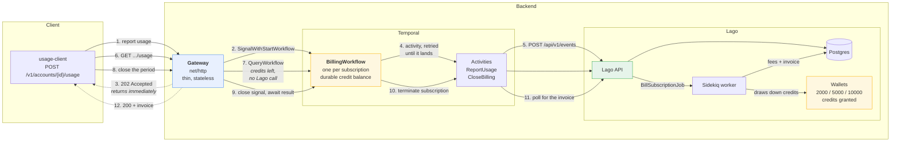
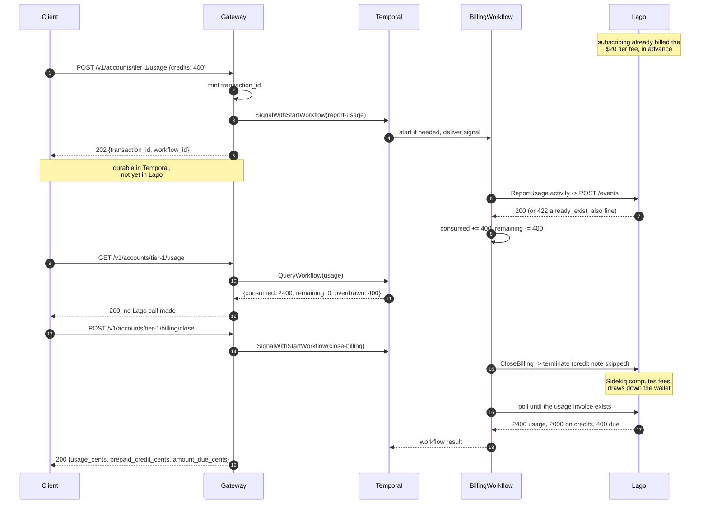

# A metered-billing demo: gateway, Temporal, Lago

This ties the rest of the module into one small system. A client reports credit usage to an
HTTP gateway; the gateway hands it to Temporal; Temporal delivers it to Lago, tracks the
remaining credit balance and owns the billing period; Lago meters it, draws down the
customer's prepaid credits and issues the invoices. The client gets an invoice back without
knowing any of that happened.

Three customers sit on three subscription tiers - \$20, \$40 and \$60 a month, bundling 2000,
5000 and 10000 credits - so one goes over their allowance and two stay inside it.




## Why Temporal is here

The honest test of a demo like this is whether you could delete the middle and lose nothing.
Here you would lose three things.

**Durable delivery, so the gateway can be fast and Lago can be down.** The gateway's job
ends the moment Temporal has the signal, which is why `POST /v1/usage` answers `202` in
milliseconds and never blocks on Rails. From there the activity retries with backoff and
*no maximum attempts* - if Lago is restarting, usage queues up and lands when it returns
rather than being dropped or pushed back onto the client. Without this the gateway would
have to own a retry queue, a dead-letter store and a backoff policy of its own.

**A live credit balance Lago cannot provide.** This one is not a convenience. Lago has a
real-time credit figure, `credits_ongoing_balance`, but it is recomputed by a clock job that
opens with `return unless License.premium?` - so on self-hosted OSS it never moves, and the
settled balance only changes when an invoice is finalized. Asking Lago "how many credits
does this customer have left" mid-period simply does not work. The workflow accumulates it
durably instead, so `GET /v1/accounts/{id}/usage` can answer honestly, with Lago remaining
the authority at settlement.

**Per-subscription state, with no database of our own.** The workflow id is derived from the
subscription, so `SignalWithStartWorkflow` gives exactly one durable, serialised accumulator
per subscription - started on demand, with neither side tracking whether it already exists.
`GET /v1/usage` is served by querying workflow state, so the running total costs nothing and
touches neither Lago nor a database the gateway maintains.

**A billing lifecycle that is naturally a long-running process.** "Accumulate usage until
the period ends, then invoice" is a timer and a signal racing in a `workflow.Selector`.
Lago's own scheduler is a cron over every subscription; this is one process per subscription
that can also be closed early, queried mid-period, and resumed after a crash.

And the piece that makes retries safe: **the gateway mints the transaction id once**, and it
stays fixed across every retry. Lago rejects a transaction id it has already recorded, and
`ReportUsage` treats that rejection as success. That single detail is what keeps
at-least-once *delivery* from becoming at-least-once *billing* - and it is asserted in both
the unit tests and the end-to-end test.

## The request path, in order



Note which calls block and which do not. Reporting usage never waits for Lago. Closing the
period does, because the caller asked for an invoice, and that wait covers both the workflow
and Lago's own background job.

## Running it

### As a test

```bash
# Workflow logic and the Lago HTTP contract. No Docker - a fake Lago built with
# this module's own mock-h package stands in.
go test -short ./demo/...

# The whole thing: five containers, a real worker, a real gateway, HTTP in and an invoice out.
go test -v -timeout 30m ./demo/...
```

### By hand

```bash
# 1. Lago
cd lago/compose && cp .env.example .env
printf 'LAGO_RSA_PRIVATE_KEY=%s\n' "$(openssl genrsa 2048 2>/dev/null | openssl base64 -A)" >> .env
docker compose up -d --wait && cd -

# 2. Temporal
temporal server start-dev            # or reuse lago/temporal's containerized one

# 3. The backend: provisions Lago, runs the worker, serves the gateway
go run ./demo/cmd/gateway

# 4. The client
go run ./demo/cmd/usage-client
```

```
Tier 1 (tier-1): $20.00/month, 2000 credits included
  reporting 2400 credits - over the allowance
  gateway reports 2400 credits consumed, 0 remaining (400 over)
  invoice GO--D340-011-002 (finalized): 2400 cents of usage, 2000 on credits, 400 to pay
  billed 2400 cents for the period; wallet now 0.0 credits

Tier 2 (tier-2): $40.00/month, 5000 credits included
  reporting 5000 credits - exactly the allowance
  gateway reports 5000 credits consumed, 0 remaining
  invoice GO--D340-012-002 (finalized): 4000 cents of usage, 4000 on credits, 0 to pay
  billed 4000 cents for the period; wallet now 0.0 credits

Tier 3 (tier-3): $60.00/month, 10000 credits included
  reporting 3000 credits - well under the allowance
  gateway reports 3000 credits consumed, 7000 remaining
  invoice GO--D340-013-002 (finalized): 1800 cents of usage, 1800 on credits, 0 to pay
  billed 6000 cents for the period; wallet now 7000.0 credits
```

The gateway provisions a fresh Lago account on each start and publishes it at
`/v1/account`, so the client needs no arguments. Watch the workflow at
<http://localhost:8233> and the invoice at <http://localhost:8088>.

## The gateway's API

| Method | Path | Behaviour |
| --- | --- | --- |
| `GET` | `/healthz` | Liveness |
| `GET` | `/v1/accounts` | Every provisioned account and its tier, so a client needs no flags |
| `GET` | `/v1/accounts/{id}` | One account |
| `POST` | `/v1/accounts/{id}/usage` | Report usage. **`202`** once Temporal has it - does not wait for Lago |
| `GET` | `/v1/accounts/{id}/usage` | Credits consumed and **remaining**, answered from workflow state |
| `POST` | `/v1/accounts/{id}/billing/close` | Close the period and **wait**, returning the invoice |

`{id}` is the tier code, since the demo provisions one customer per tier.

`POST .../usage` accepts an optional `transaction_id`. Supply one and a client-side retry is
idempotent end to end; omit it and the gateway mints one, which still makes every retry
*inside* the backend idempotent - and with credits at stake, that is the difference between
charging a customer once and charging them twice.

## Files

| File | Purpose |
| --- | --- |
| `gateway.go` | The HTTP front door. Validates, signals Temporal, answers |
| `workflow.go` | `BillingWorkflow`: one billing period per subscription |
| `activities.go` | The activities that reach Lago, and the idempotency rule |
| `provision.go` | Creates the meter, the three tier plans, and a customer, subscription and credit wallet for each |
| `cmd/gateway/` | Runs the worker and the gateway together |
| `cmd/usage-client/` | The client: reports usage, reads the total, closes the period |
| `activities_test.go` | Real activity code against a **mock-h** fake Lago, no Docker |
| `workflow_test.go` | Orchestration against Temporal's test env, Lago mocked out |
| `demo_test.go` | Everything, against real containers |

## Design notes

- **The three test layers are deliberate.** `workflow_test.go` asks "does the orchestration
  make the right decisions", with Lago mocked out entirely and the clock skipped so an
  hour-long billing period tests instantly. `activities_test.go` asks "is the HTTP contract
  with Lago right", using `mock-h` to impersonate Lago - including a `422
  value_already_exist` response, which is awkward to provoke against a real server but is
  exactly the case that matters. `demo_test.go` asks "does it actually work", end to end.
  Only the last one needs Docker.
- **One process runs the worker and the gateway.** That is a demo convenience. They are
  separate concerns and would be separate deployments: the gateway scales with client
  traffic, the worker with billing work.
- **A bad usage report is tolerated; a failure to invoice is not.** A report that can never
  be delivered is counted in `events_rejected` and the period carries on, because one
  malformed report should not take down a subscription's billing. A `CloseBilling` failure
  fails the workflow, because silently not invoicing is worse than a visible error.
- **The close path is written to survive a retry.** On a second attempt the subscription is
  already terminated and the terminate call fails, so `CloseBilling` logs it and goes looking
  for the invoice anyway - the first attempt's invoice is the one that was asked for.
- **`activityStub`** is a nil `*Activities` that exists only so workflow code can name
  activities in a way the compiler checks. The SDK resolves the method to its registered
  name by reflection and never dereferences it.
