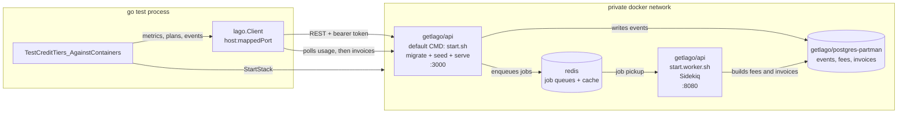

# Self-hosted Lago, driven from Go

[Lago](https://github.com/getlago/lago) is an open-source metering and billing platform.
This package stands a whole one up in Docker and bills a credit-tier product against it:
three subscription tiers, a customer picks one, and each bundles a monthly allowance of
credits that usage events draw down. There are two ways in:

1. **The Go test** - `container.go` boots a four-container Lago with testcontainers, and
   `container_test.go` puts three customers on the three tiers, reports usage, and asserts
   on the invoices and the credit balances that come out. Nothing to set up and nothing left
   running.
2. **The compose stack** - `compose/docker-compose.yml` runs the same thing plus the web UI
   and the scheduler, with data that survives a restart, for clicking around.

`TUTORIAL.md` explains Lago's domain model and the billing configuration itself.

## Running

```bash
# The tier arithmetic only. No Docker, no containers - the fast feedback loop.
go test -short ./lago/...

# The real thing: four containers, three customers, real invoices.
go test -v -timeout 20m ./lago/...

# Treat a missing Docker daemon as a failure rather than a skip.
GO_BILL_REQUIRE_DOCKER=1 go test -v -timeout 20m ./lago/...
```

The containerized test is gated on `testing.Short()` rather than a build tag, matching
`temporal/`. A build tag was rejected because it hides the test from `go vet ./...` and
makes it easy to forget in CI; `-short` keeps it compiled and checked either way. On top of
that, `skipIfNoDocker` probes the daemon up front so an absent Docker produces a clean skip
instead of a confusing container-start failure.

Expect roughly 90 seconds on warm images, almost all of it Lago's Rails migrations.

## The compose stack

```bash
cd lago/compose
cp .env.example .env
# Lago signs webhooks with an RSA key and has no default for it, so generate one.
printf 'LAGO_RSA_PRIVATE_KEY=%s\n' "$(openssl genrsa 2048 2>/dev/null | openssl base64 -A)" >> .env

docker compose up -d --wait
```

Then the UI is at <http://localhost:8088>, the API at <http://localhost:3000>, and Sidekiq's
dashboard at <http://localhost:3000/sidekiq>. Log in with the `LAGO_ORG_USER_EMAIL` and
`LAGO_ORG_USER_PASSWORD` from `.env`; `LAGO_ORG_API_KEY` is the bearer token for the API.

To put something in it worth looking at, seed the same billing configuration the test
uses and walk it to an invoice:

```bash
go run ./lago/cmd/lago-seed
```

```
tier catalog:
  tier-1   $20.00/month    2000 credits  $0.0100/credit
  tier-2   $40.00/month    5000 credits  $0.0080/credit
  tier-3   $60.00/month   10000 credits  $0.0060/credit

metric credits_190909 and 3 tier plans created

over-spender   tier-1: $20.00/month, 2000 credits granted
               advance invoice GO--D68D-001-001: 2000 cents
               used 2400.0 credits over 6 events, 0 remaining
               usage invoice GO--D68D-001-002: 2400 cents of usage, 2000 on credits, 400 to pay
               wallet now 0.0 credits; billed 2400 cents total (expected 2400)
...
```

`docker compose down -v` removes the volumes too, resetting to an empty instance.

## Pinned versions

| Dependency | Version |
| --- | --- |
| `github.com/getlago/lago-go-client` | `v1.55.0` |
| `github.com/testcontainers/testcontainers-go` | `v0.44.0` |
| Docker image | `getlago/api:v1.55.0` (API and worker) |
| Docker image | `getlago/front:v1.55.0` (compose only) |
| Docker image | `getlago/postgres-partman:15.0-alpine` |
| Docker image | `redis:7-alpine` |

**Do not drop to `getlago/api:v1.54.0.`** It shipped with an inherited `ENTRYPOINT`, which
demotes a `command` override to mere arguments - the worker container would silently boot a
second API instead of Sidekiq - and without `curl` on `PATH`, which breaks the compose
healthchecks. Both are fixed and CI-asserted on v1.55.0.

## Four containers, and why each is load-bearing



- **`api`.** Runs with **no command override**, which is the detail that makes this simple.
  The image's default CMD is `scripts/start.sh`: `db:migrate`, then `roles:seed_predefined`,
  then `signup:seed_organization`, then `exec rails s`, all under `set -e`. One container
  migrates, seeds our organization and serves, so a 200 from `/health` already implies the
  API key exists. Upstream's compose needs a separate one-shot `migrate` service only
  because it overrides the command with `start.api.sh`, which skips migrations.
- **`worker`.** Not optional. Lago builds invoices in Sidekiq jobs, and the REST layer gives
  no way to run them inline - `Subscriptions::TerminateService` is invoked without an
  `async` argument, so it defaults to async and enqueues `BillSubscriptionJob`. Without this
  container events are still ingested and usage still aggregates, but **no invoice is ever
  produced**, and the test would simply time out waiting.
- **`postgres`.** Must be upstream's partman image. See Gotchas.
- **`redis`.** Sidekiq's queues plus the Rails cache.

Deliberately absent from the test: `front` (no UI needed headlessly), `pdf` (switched off
with `LAGO_DISABLE_PDF_GENERATION`), and ClickHouse and Kafka, which are disabled by leaving
their environment variables unset rather than by any flag.

`clock`, the scheduler, is absent too, and it is worth saying why it stays absent now that
credits are involved. It would matter for two things: billing at period rollover, which the
test sidesteps by terminating a subscription, and refreshing a wallet's **ongoing** credit
balance. The latter looks like exactly what this package needs - except
`Clock::RefreshWalletsOngoingBalanceJob` opens with `return unless License.premium?`, so on
OSS it never does anything. Adding the container would buy nothing. The compose stack runs it
anyway, since there a real month can actually pass.

This is the repo's first multi-container stack, and `temporal/README.md` argues against
exactly that shape - "a second container, a network, and an ordering dependency - all of
which is startup latency and flake surface." That reasoning still holds; it just loses.
Temporal ships a single-process dev server, so there the multi-container option was pure
cost. Lago has no equivalent, so the choice is a network or no Lago at all.

## Wait strategy: three phases

- **Phase 1 (testcontainers)** - Postgres waits for its readiness line twice, because the
  entrypoint starts the server once to run init scripts and logs it then too. Redis waits
  for its own line and port. The API waits on `GET /health`, which does a real database
  round-trip, so a 200 covers Postgres as well as Rails. The worker waits on Sidekiq's
  port 8080, which upstream does not publish but which gives a real signal instead of a
  sleep.
- **Phase 2 (`waitForSeededOrg`)** - polls an authenticated endpoint until the seeded
  organization answers for its API key. A serving API is not necessarily a seeded one, and
  this turns an inference about startup ordering into a fact.
- **Phase 3 (per assertion)** - Lago does its real work asynchronously, so the test polls
  three more times: `WaitForWalletBalance` until a granted credit allowance has settled,
  `WaitForUsage` until ingestion has been attributed to the subscription, and
  `WaitForInvoiceMatching` until Sidekiq has built the invoice being waited for.

Timeouts: 5 minutes for a cold pull plus migrations, 2 minutes for each app-level poll at a
250ms interval, 20 minutes for the test overall.

## Files

| File | Purpose |
| --- | --- |
| `pricing.go` | The tier catalog and the billing arithmetic, as plain Go |
| `pricing_test.go` | Tier invariants and the three billing outcomes - the `-short` suite, no Docker |
| `container.go` | The four-container stack: network, images, environment, readiness |
| `client.go` | Client construction, the polling helpers, invoice fee lookup |
| `config.go` | The billing configuration: meter, plan, customer, subscription, events |
| `container_test.go` | Usage events in, invoice out, against real containers |
| `compose/` | The browsable stack, with the UI and the scheduler |
| `cmd/lago-seed/` | Seeds the compose stack and walks it to an invoice |
| `TUTORIAL.md` | Lago's concepts, and this configuration explained |

## Gotchas hit

- **Stock Postgres cannot host Lago.** `postgres:17` looks like it should work: every
  `pg_partman` migration checks whether the extension exists and skips when it does not. But
  a fresh database is not built by replaying migrations - `db:migrate` loads
  `db/structure.sql` through `psql`, and that file does an unguarded
  `CREATE EXTENSION pg_partman`, so the API container dies on first boot with
  `extension "pg_partman" is not available`. Upstream's `getlago/postgres-partman` exists
  for this. It is Postgres 15; no partman-carrying 16 or 17 tag is published.
- **`POSTGRES_USER` has to be a superuser**, because Lago's schema load issues
  `CREATE EXTENSION`. The official images make `POSTGRES_USER` a superuser, so this comes
  free - but it would break against a managed database with a restricted role.
- **Every Lago Go client method returns `*lago.Error`, not `error`.** A nil `*lago.Error`
  assigned to an `error` variable gives a non-nil interface holding a nil pointer, so
  `require.NoError(t, err)` fails on success. Everything here funnels through `asError`.
- **`SetBaseURL` appends `/api/v1/` itself**, so it takes `http://host:port` and nothing
  more. Relatedly, do not call `SetUseIngestService(true)`: it repoints ingestion at Lago's
  hosted service, which is not where a self-hosted instance lives.
- **Listing invoices does not return their fees.** Lago's invoice index renders without
  them; only the show endpoint includes them. Finding an invoice therefore takes two calls -
  list for the id, then fetch the id - which is what `WaitForInvoiceMatching` does.
- **A charge that aggregated zero units produces no fee at all**, so an invoice's `fees`
  slice cannot be indexed blindly. `ChargeFee` and `SubscriptionFee` search by item type.
- **A customer ends a period with two invoices that look identical by type.** The tier fee
  is invoiced at subscribe time because the plans are pay-in-advance, and the usage when the
  period closes - and **both** are `invoice_type: "subscription"`. Only their fees tell them
  apart, which is why the waiters take a predicate rather than a type.
- **Terminating a pay-in-advance subscription issues a credit note** for the unused part of
  the month, and a credit note reduces how much prepaid credit an invoice may absorb. Left
  on, a customer owed 2000 credits of offset got 465. Fixed with
  `on_termination_credit_note: skip`.
- **A wallet needs `applies_to.fee_types: ["charge"]`.** Unrestricted, it pays every fee on
  the invoice including the monthly subscription fee, so a customer inside their allowance
  would have their own credits pay their tier fee - billing $18 instead of $60.
- **Granted credits arrive asynchronously.** `granted_credits` creates a wallet transaction
  that Sidekiq settles, so a wallet read immediately after creation reports zero. This cost
  one confusing failure before `WaitForWalletBalance` existed.
- **Lago's live credit balance is premium.** `credits_ongoing_balance` is recomputed by a
  clock job that returns early without a license, so on OSS only `credits_balance` moves,
  and only at invoice finalization. Likewise `recurring_transaction_rules` for a monthly
  credit reset is premium and is dropped **silently** - the wallet is created without it and
  nothing says so.
- **`LAGO_RSA_PRIVATE_KEY` has no default** and Lago needs it for webhook signatures. The Go
  stack generates one per run with `crypto/rsa`, so there is no dependency on an `openssl`
  binary.
- **Nothing happens at period rollover without the `clock` container.** The test sidesteps
  this by terminating a subscription to force billing; the compose stack includes `clock` so
  rollover actually works there.
