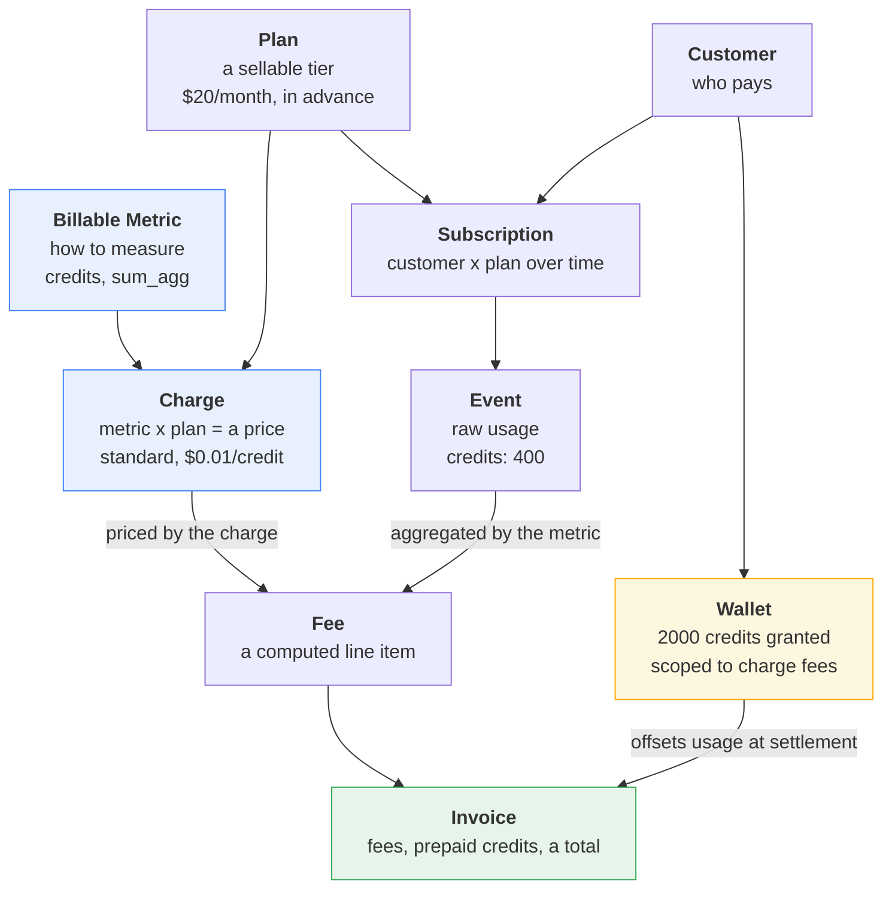
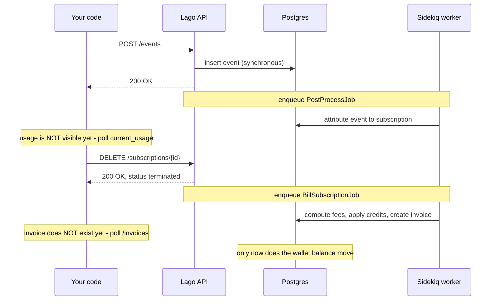

# Lago, from zero to an invoice

[Lago](https://github.com/getlago/lago) is an open-source metering and billing platform. You
tell it how to measure usage, how to price it, and who is being billed; you then fire raw
usage events at it and it produces invoices.

This tutorial walks the model in the order you have to build it, with Go from this package.
The configuration it builds is a **credit-tier** product: three subscription tiers, a
customer picks one, and each bundles a monthly allowance of credits that usage draws down.

Everything here runs against the self-hosted stack in `container.go` - see `README.md` for
how to start it.

## The shape of the thing



Two splits are worth internalising:

- **A billable metric knows how to measure but nothing about money**, and a charge is where
  a metric meets a plan and acquires a price. The same `credits` meter is priced three
  different ways by the three tier plans.
- **A wallet is not a discount**, it is prepaid value. It sits beside the subscription and
  offsets what usage costs at settlement.

## 0. Organization and API key

An organization is the top-level tenant. You do not create one through the billing API -
there is no `POST /organizations`, only `GET` and `PUT`. It comes into being when the
instance is installed.

For self-hosted Lago, four environment variables seed one at boot and pin its API key to a
value you choose, which is what makes a test possible at all:

```
LAGO_CREATE_ORG=true
LAGO_ORG_NAME=go-bill
LAGO_ORG_USER_EMAIL=go-bill@example.local
LAGO_ORG_USER_PASSWORD=go-bill-local-password
LAGO_ORG_API_KEY=go-bill-local-api-key
```

All four are mandatory together; with `LAGO_CREATE_ORG=true` and any of the others missing,
the seeding task raises and the container exits. Lago enforces no format on the key.

```go
// SetBaseURL appends /api/v1/ itself, so pass only scheme, host and port.
client := lagoapi.New().
    SetApiKey("go-bill-local-api-key").
    SetBaseURL("http://localhost:3000")
```

> **Two traps in the Go client.** Every method returns `*lago.Error`, not `error`. A nil
> `*lago.Error` placed in an `error` variable yields a non-nil interface holding a nil
> pointer, so `require.NoError(t, err)` fails on success - this package funnels everything
> through `asError` in `client.go`. And never call `SetUseIngestService(true)` against
> self-hosted Lago: it repoints event ingestion at Lago's hosted service.

## 1. Billable metric: how to measure

A metric is a meter definition. It names a `code` that events will carry, an
`aggregation_type`, and usually a `field_name` naming the property on each event to
aggregate.

| `aggregation_type` | What it does |
| --- | --- |
| `count_agg` | Counts events. The only type that needs no `field_name` |
| `sum_agg` | Sums a numeric property across the period |
| `max_agg` | The largest value seen |
| `latest_agg` | The most recent value |
| `unique_count_agg` | How many distinct values appeared |
| `weighted_sum_agg` | Sums a gauge, prorated by how long it held each value |

```go
metric, lerr := client.BillableMetric().Create(ctx, &lagoapi.BillableMetricInput{
    Name:            "Credits",
    Code:            "credits",
    AggregationType: lagoapi.SumAggregation,
    FieldName:       "credits", // reads event.properties.credits
    Recurring:       false,     // usage resets each billing period
})
```

`sum_agg` is right here because each event reports how many credits it consumed and we want
the arithmetic total for the period. `weighted_sum_agg` would be for a gauge - "GPUs
currently allocated" - where you care how long each value held. `Recurring: false` resets
the counter each period; `true` would carry the running total forward forever.

**All three tiers share this one metric.** A metric carries no price, so one meter priced
three different ways is the natural shape rather than a shortcut.

> `latest_agg` exists in the API but has no Go constant. Use
> `lagoapi.AggregationType("latest_agg")` if you need it. There is also a stale
> `RecurringCountAggregation` constant the current API no longer accepts.

## 2. Plan and charge: what it costs

A plan is a sellable package with an interval and a recurring fee. Its charges attach metrics
to prices.

```go
plan, lerr := client.Plan().Create(ctx, &lagoapi.PlanInput{
    Name:           "Tier 1",
    Code:           "tier-1",
    Interval:       lagoapi.PlanMonthly,
    AmountCents:    2000,  // $20.00 a month
    AmountCurrency: lagoapi.USD,
    PayInAdvance:   true,  // see "Why in advance" below
    Charges: []lagoapi.PlanChargeInput{{
        // A charge references its metric by Lago's UUID, never by code - so the
        // metric has to be created first and its LagoID captured.
        BillableMetricID: metric.LagoID,
        ChargeModel:      lagoapi.StandardChargeModel,
        AmountCurrency:   lagoapi.USD,
        Properties: map[string]any{
            "amount": "0.0100", // $0.01 per credit
        },
    }},
})
```

### The seven charge models

| `charge_model` | Shape of `properties` |
| --- | --- |
| `standard` | `amount` - one price per unit, forever |
| `package` | `amount`, `package_size`, `free_units` - sold in blocks |
| `graduated` | `graduated_ranges[]` - marginal tiers inside one charge |
| `volume` | `volume_ranges[]` - all units at the rate of the band the total lands in |
| `percentage` | `rate`, `fixed_amount`, free-unit allowances |
| `graduated_percentage` | `graduated_percentage_ranges[]` - tiered percentages |
| `dynamic` | none; each event carries its own `precise_total_amount_cents` |

Charge properties have no typed representation in the Go client - they are
`map[string]interface{}`, so a misspelled key is a runtime surprise rather than a compile
error.

### Why `standard`, and not `graduated`

`graduated` and `volume` both put a price ladder *inside a single charge*: usage gets
cheaper per unit as it grows, automatically, on one plan. That is a different product shape
from the one here.

This configuration puts the ladder in the **catalog of plans** instead. The customer chooses
a tier up front and gets that tier's flat rate, so each charge needs only one price and
`standard` is all it takes. Worth knowing the distinction, because the two are easy to
conflate:

- **`graduated`** - one plan, marginal bands. The first 100 units cost $1 each, the next 100
  cost $0.50 each. Every customer traverses the same ladder as they consume.
- **`volume`** - one plan, all-units. The total lands in one band and *every* unit is priced
  at that band's rate, so the bill can **fall** as usage crosses a boundary.
- **Tier selection, used here** - three plans. The customer commits to a monthly fee, and
  the better unit price is something they bought rather than something they grew into.

## 3. The tier catalog

| Tier | Monthly fee | Credits included | Rate per credit |
| --- | --- | --- | --- |
| `tier-1` | $20.00 | 2000 | $0.0100 |
| `tier-2` | $40.00 | 5000 | $0.0080 |
| `tier-3` | $60.00 | 10000 | $0.0060 |

The invariant that makes this coherent: **the monthly fee equals credits x rate**. 2000
credits at $0.01 are worth exactly the $20 the tier costs. That equality is why usage inside
the allowance nets to zero against the granted credits and the customer is billed just the
fee. `pricing_test.go` asserts it for every tier, so a hand-edit that breaks it fails the
build.

The charge price and the wallet's `rate_amount` **must be the same number**, or one credit
of usage would not cost one credit of allowance. That is why `pricing.go` holds the rate once
and hands the same string to both.

### Why the fee is charged in advance

`PayInAdvance: true` is not a stylistic choice. A plan billed in arrears and terminated
mid-period has its monthly fee **prorated**, so a subscription opened and closed minutes
apart bills a few cents instead of $20. Charging in advance invoices the whole fee up front.

The cost is that **the tier fee and the usage land on separate invoices**: one when the
customer subscribes, one when the period closes. Section 7 covers how to tell them apart.

## 4. Wallets and credits

A wallet is a customer's prepaid credit balance. `rate_amount` is the currency value of one
credit, so the balance is meaningful in both units at once.

```go
code := "credits"
wallet, lerr := client.Wallet().Create(ctx, &lagoapi.WalletInput{
    ExternalCustomerID: "tier-1-customer",
    Name:               "Tier 1 credits",
    Code:               &code,
    Currency:           lagoapi.USD,
    RateAmount:         "0.0100", // one credit is worth one cent
    GrantedCredits:     "2000",
    AppliesTo: lagoapi.AppliesTo{
        FeeTypes: []string{"charge"},
    },
})
```

Three details carry the whole model.

**`granted_credits`, not `paid_credits`.** Granted credits are free: the balance goes up and
no invoice is issued. `paid_credits` bills the customer for them as a *separate* `credit`
invoice, which here would double-charge for an allowance the monthly fee already covers.

**`applies_to.fee_types: ["charge"]` is load-bearing.** Without it, a wallet pays *every*
fee on an invoice - the monthly subscription fee included. A customer who stayed comfortably
inside their allowance would have their own credits pay their tier fee, and the bill would
come out at $18 instead of $60. Scoping the wallet to charge fees makes credits offset usage
only. The field is not premium.

**Credits are applied post-tax.** With any tax rate, an allowance would not exactly absorb
its own worth of usage, because tax on the usage charge eats into it. This configuration
creates no taxes, and that is what keeps the arithmetic exact.

### Settled balance versus ongoing balance

A wallet reports its balance twice over, and the difference matters enormously on
self-hosted OSS:

| Field | Meaning | Works on OSS? |
| --- | --- | --- |
| `credits_balance` / `balance_cents` | **Settled.** Moves when an invoice is finalized and credits are actually drawn down | **Yes** |
| `credits_ongoing_usage_balance` | Uninvoiced usage drawn so far this period | No - premium |
| `credits_ongoing_balance` | Real-time "credits left" = settled minus ongoing usage | No - premium |

The ongoing figures are recomputed by `Clock::RefreshWalletsOngoingBalanceJob`, which opens
with `return unless License.premium?`. So **on OSS there is no live credit balance from
Lago** - the balance you read only moves at invoicing. Running Lago's `clock` container does
not change that.

This is worth planning around rather than discovering. In this module the Temporal workflow
in `demo/` holds the running total durably and serves the live "credits remaining" readout,
with Lago remaining the authority at settlement. See `demo/README.md`.

```go
// The settled balance, which is the one that moves on OSS.
wallet, err := lago.Wallet(ctx, client, "tier-1-customer")
// wallet.CreditsBalance  -> "0.0"     (decimal strings, so parse them)
// wallet.ConsumedCredits -> "2000.0"
```

> **Granted credits arrive asynchronously.** `granted_credits` creates a wallet transaction
> that Sidekiq settles, so a wallet created a moment ago still reports a zero balance. Poll
> for it - `WaitForWalletBalance` in `client.go` does.

### What a monthly reset would need

Credits here are seeded once, at wallet creation. A recurring monthly top-up is a
`recurring_transaction_rules` entry:

```go
RecurringTransactionRules: []lagoapi.RecurringTransactionRuleInput{{
    Trigger:              "interval",
    Interval:             "monthly",
    Method:               "target",
    TargetOngoingBalance: "2000",  // top back up TO 2000, not BY 2000
    GrantsTargetTopUp:    &yes,
}},
```

**This is premium, and it fails silently.**
`Wallets::RecurringTransactionRules::CreateService` returns before doing anything without a
license, so the wallet is created with the rule quietly dropped and nothing tells you. Note
also that `method: "fixed"` *adds* credits while `"target"` tops up *to* a number - only
`target` gives use-it-or-lose-it.

Without a license, the OSS route is to re-grant credits yourself each period with
`POST /wallet_transactions` (`granted_credits`), scheduled by something you own.

## 5. Customer and subscription: who, and since when

```go
customer, lerr := client.Customer().Create(ctx, &lagoapi.CustomerInput{
    ExternalID: "tier-1-customer",  // your id, not Lago's
    Name:       "Comfy Compute (Tier 1)",
    Currency:   lagoapi.USD,
})

sub, lerr := client.Subscription().Create(ctx, &lagoapi.SubscriptionInput{
    ExternalCustomerID: "tier-1-customer",
    ExternalID:         "tier-1-subscription", // what events will reference
    PlanCode:           "tier-1",
    BillingTime:        lagoapi.Anniversary,
})
```

The subscription's `ExternalID` is separate from the customer's and it is the one that
matters operationally: **usage events attach to a subscription, not to a customer**, because
one customer may hold several.

`BillingTime` picks the period boundary. `Calendar` bills on the 1st of the month, so a
customer subscribing on the 28th gets a very short first period. `Anniversary` runs the
period from the subscription date.

Because the plan is pay-in-advance, **this call already bills the monthly fee** - there is an
invoice for $20 before any usage exists.

## 6. Events: the raw usage

```go
_, lerr := client.Event().Batch(ctx, []lagoapi.EventInput{{
    TransactionID:          "credits-7f3a2b01-0", // the idempotency key
    ExternalSubscriptionID: "tier-1-subscription",
    Code:                   "credits",            // the metric's code
    Properties:             map[string]any{"credits": 400},
}})
```

Five things to know:

- **`TransactionID` is the idempotency key.** Replay one and Lago answers `422` with
  `value_already_exist` rather than double-spending the customer's credits. So do not blindly
  retry on 422 - treat that specific code as success. `container_test.go` asserts this.
- **Omitting `Timestamp` is usually right.** Lago then stamps reception time. If you do set
  it, it is **Unix seconds** (decimals allowed), not milliseconds - passing milliseconds puts
  the event tens of thousands of years in the future, where it matches no subscription. The
  field is a `string` on input but a `time.Time` on the response.
- **An event outside the subscription's active window is silently dropped**, not rejected.
  Events are matched on `started_at <= timestamp` and `terminated_at >= timestamp`.
- **An unknown `Code` is also silently ignored.** A typo in a metric code does not error at
  ingestion; it surfaces later as an `event.error` webhook. This is the easiest way to lose
  revenue quietly.
- **Ingestion is only half synchronous.** The event row is written during the request, so a
  `200` means durable. Attributing it to a subscription happens in a background job, so usage
  trails ingestion.

That last point is why `WaitForUsage` exists. Checking usage immediately after posting events
races the job and sees a partial total:

```go
usage, err := lago.WaitForUsage(ctx, client, customerID, subscriptionID, 2400, 6)
```

Under the hood that polls `GET /customers/{id}/current_usage`, which is useful in its own
right: it prices current consumption **before any invoice exists**, so you can verify
aggregation and pricing independently of invoicing.

## 7. Fees and invoices: the output

A **fee** is a computed line item: one per charge per period, or one per plan fee. An
**invoice** is a container of fees, with prepaid credits and taxes applied to reach a total.

A customer on these tiers ends a period with **two** invoices:

| Invoice | When | Fees it carries |
| --- | --- | --- |
| The tier fee | At subscribe time, because the plan is pay-in-advance | one `subscription` fee |
| The usage | When the period closes | one `charge` fee, offset by prepaid credits |

**Both have `invoice_type: "subscription"`.** Nothing in Lago's list filters tells them
apart - what distinguishes them is which fees they hold. Hence the matcher helpers:

```go
advance, err := lago.WaitForInvoiceMatching(ctx, client, customerID,
    "advance invoice", lago.HasSubscriptionFee())

usage, err := lago.WaitForInvoiceMatching(ctx, client, customerID,
    "usage invoice", lago.HasChargeFee("credits"))
```

Two non-obvious details are baked into those helpers:

- **Listing invoices does not return their fees.** The index endpoint renders without them;
  only the show endpoint includes them. Finding an invoice therefore takes two calls - list
  for the id, then fetch the id.
- **A charge that aggregated zero units produces no fee at all.** Never index `Fees[0]`;
  search by item type and code, as `ChargeFee` and `SubscriptionFee` do.

### Getting the usage invoice without waiting a month

Lago offers no "invoice now" endpoint:

| Approach | Verdict |
| --- | --- |
| Wait for period close | Correct, but needs the `clock` service and a month |
| `POST /invoices` (one-off) | **Cannot carry metered usage** - every fee needs an `add_on_code` |
| `POST /invoices/preview` | Synchronous and useful, but hypothetical: it reads no recorded events and persists nothing |
| Usage thresholds / progressive billing | A premium add-on |
| Time travel | Does not exist |
| **Terminate the subscription** | **The one that works** |

```go
_, err := lago.TerminateSubscription(ctx, client, subscriptionID)
```

**One flag matters enormously here.** Terminating a *pay-in-advance* subscription makes Lago
issue a **credit note** refunding the unused part of the prepaid month. That both contradicts
"the month is paid for" and quietly breaks the credit arithmetic, because a credit note
reduces how much of an invoice prepaid credits are allowed to cover. Left on, a customer who
should have had 2000 credits applied gets 465. So:

```go
OnTerminationCreditNote: lagoapi.OnTerminationCreditNoteSkip,
```

The invoice also does not exist when the call returns - termination enqueues
`BillSubscriptionJob` on Sidekiq - so you poll.

### Reading the result

```go
fee, err := lago.ChargeFee(invoice, "credits")
// fee.AmountCents                   -> 2400   usage before credits
// invoice.PrepaidCreditAmountCents  -> 2000   absorbed by the allowance
// invoice.TotalAmountCents          ->  400   the overage, all that is left to pay
```

And the figure actually worth asserting on, since the fee and the usage are on separate
invoices:

```go
total, err := lago.TotalInvoicedCents(ctx, client, customerID)  // 2400 = $20 fee + $4 overage
```

### The three outcomes

This is what the configuration produces, verified in `container_test.go`:

| Tier | Credits used | Tier invoice | Usage | On credits | To pay | **Total** | Wallet after |
| --- | --- | --- | --- | --- | --- | --- | --- |
| `tier-1` | 2400 of 2000 | $20.00 | $24.00 | $20.00 | $4.00 | **$24.00** | 0 credits |
| `tier-2` | 5000 of 5000 | $40.00 | $40.00 | $40.00 | $0.00 | **$40.00** | 0 credits |
| `tier-3` | 3000 of 10000 | $60.00 | $18.00 | $18.00 | $0.00 | **$60.00** | 7000 credits |

Inside the allowance you pay the fee and nothing more. Past it, you pay the fee plus the
overage at your tier's rate.

### Invoice enums

`status`: `draft`, `finalized`, `voided`, `failed`, `pending`, `deleted`. A `draft` is
waiting out a grace period and can still absorb events; `finalized` cannot. Grace periods
are premium, so on OSS invoices finalize directly. `payment_status` is `pending`, `succeeded`
or `failed`, and `sequential_id` is null until finalization.

## 8. Everything else, briefly

| Concept | What it is |
| --- | --- |
| **Billing entity** | A sub-issuer under the organization. Invoices are issued *by* one; a default always exists |
| **Coupon** | A discount, `fixed_amount` or `percentage`, once or recurring. Must be *applied* to a customer via `POST /applied_coupons` |
| **Add-on** | A one-off priced item. Only usable through one-off invoices |
| **Credit note** | A correction against an already-finalized invoice, split across credit, refund and offset. Lago issues one automatically when a prepaid subscription is terminated early - see section 7 |
| **Tax** | A named rate attachable at organization, customer, plan or charge level - most specific wins |
| **Filters** | Declared on a metric, then priced per combination on a charge. Differentiated pricing, e.g. by region |
| **Wallet alerts** | Threshold notifications on a credit balance. Premium |
| **Usage thresholds** | Progressive billing when lifetime usage crosses a line. Premium |

## Why hasn't my invoice appeared?

Almost every surprise with Lago is the same surprise: the API accepted your call, and the
work happens later on a queue.



The checklist, in the order things usually go wrong:

1. **Is the `worker` container running?** No Sidekiq, no invoices, ever - and no wallet
   top-ups either. Events still ingest and usage still aggregates, which makes this a
   confusing failure rather than an obvious one.
2. **Did you poll?** Ingestion, invoicing and wallet settlement are all eventually
   consistent.
3. **Does the event's `code` match the metric's `code` exactly?** A mismatch is dropped
   silently.
4. **Is the event's timestamp inside the subscription's active window?** Outside it, also
   dropped silently.
5. **Did the charge aggregate any units?** Zero units produces no fee, so there may be no
   usage invoice at all.
6. **Are you reading the settled balance or the ongoing one?** `credits_ongoing_balance`
   never moves on OSS. Read `credits_balance`, and only expect it to change at invoicing.
7. **Did a credit note eat your credits?** Terminating a pay-in-advance subscription issues
   one unless you pass `on_termination_credit_note: skip`, and it reduces how much prepaid
   credit can be applied.
