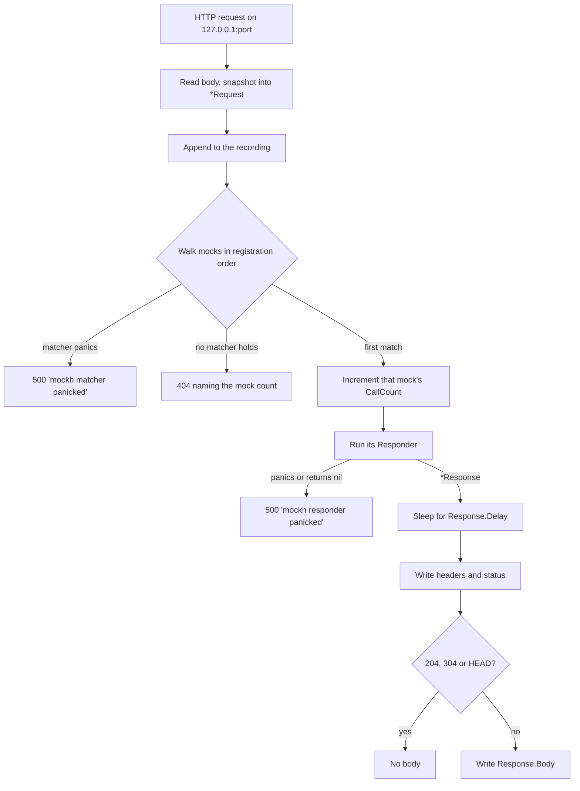

# mockh

A mock HTTP server for Go tests. Register matchers against responses, point the
code under test at a real `127.0.0.1` socket, then assert on what it sent.

Stdlib only - no dependencies. Ported from the Kotlin `dim-mak` library.

Directory is `mock-h/`; the Go package name is `mockh` (identifiers cannot
contain hyphens).

```go
import mockh "comfy/go-bill/mock-h"
```

## Usage

```go
func TestCheckout(t *testing.T) {
    server := mockh.MustStart(0) // 0 = ephemeral port
    defer server.Close()

    // Mocks are consulted in registration order; the first match wins,
    // so specific mocks go first and a catch-all goes last.
    created := server.MockResponse(
        mockh.And(mockh.Post("/orders"), mockh.HeaderContaining("Authorization", "Bearer ")),
        mockh.JSON(`{"id":1}`).WithStatus(201).WithHeader("Location", "/orders/1"),
    )

    server.Mock(mockh.PathTemplateMatching("/orders/{id}"), func(r *mockh.Request) *mockh.Response {
        return mockh.JSON(`{"id":` + r.PathVariables("/orders/{id}")["id"] + `}`)
    })

    server.MockResponse(mockh.Any(), mockh.NotFound("nothing mocked for that"))

    client := NewAPIClient(server.BaseURL()) // or server.URL("/orders")
    // ... exercise the client ...

    if created.CallCount() != 1 {
        t.Fatalf("CallCount() = %d, want 1", created.CallCount())
    }
    if n := server.ReceivedCount(mockh.BodyContains(`"total"`)); n != 1 {
        t.Fatalf("ReceivedCount = %d, want 1", n)
    }
}
```

## Request flow



## API at a glance

| Area | Identifiers |
| --- | --- |
| Lifecycle | `Start(port) (*MockServer, error)`, `MustStart(port)`, `Stop() error`, `Close() error` |
| Addressing | `Port()`, `BaseURL()`, `URL(path)` |
| Registration | `Mock(Matcher, Responder) *Mock`, `MockResponse(Matcher, *Response) *Mock`, `Mock.CallCount()` |
| Verification | `Requests()`, `Received(Matcher)`, `ReceivedCount(Matcher)`, `Clear()` |
| Combinators | `And(...)`, `Or(...)`, `Not(m)` |
| Verb + path | `Any()`, `Method`, `Path`, `PathPrefix`, `PathMatching`, `PathTemplateMatching`, `Get`/`Post`/`Put`/`Patch`/`Delete`/`Head`/`Options` |
| Query | `Query`, `HasQuery`, `QueryMatching` |
| Headers | `Header`, `HasHeader`, `HeaderContaining` |
| Body | `Body`, `BodyContains`, `BodyMatching`, `EmptyBody` |
| Responses | `OK`, `JSON`, `Text`, `Status`, `NoContent`, `NotFound`, `Bytes` |
| Response builders | `WithStatus`, `WithHeader`, `WithContentType`, `WithBody`, `WithBytes`, `WithDelay` |
| Templates | `NewPathTemplate(t)`, `Matches`, `Extract`, `Names`, `Request.PathVariables` |

## Behaviour notes

- Matching is first-match-wins over the registration order.
- Request header lookups are case-insensitive; query parameter names are not.
- Repeated query parameters keep every value, and a malformed percent escape is
  passed through undecoded rather than failing the request.
- `PathMatching` and `QueryMatching` require the regexp to match in full;
  `BodyMatching` matches anywhere in the body.
- A path template placeholder matches exactly one non-empty path segment.
- 204, 304 and HEAD replies never carry a body, whatever the responder built.
- A panic in a matcher or responder becomes a 500 naming the request and the
  panic value; the server stays usable.
- An unmatched request gets a 404 saying how many mocks were registered, and is
  still recorded.
- Everything is safe for concurrent use: `sync.RWMutex` guards the mock list and
  the recording, `atomic.Int64` carries call counts, and `Requests()` returns a
  copy.

## Tests

```sh
go vet ./mock-h/... && go test -race ./mock-h/...
```
