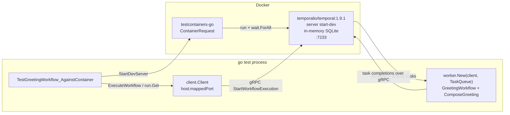

# Containerized Temporal integration test

A real Temporal workflow (`GreetingWorkflow` -> `ComposeGreeting` activity) exercised two ways:

1. **Fast, no Docker** - the SDK's in-memory `testsuite.WorkflowTestSuite`.
2. **Real server** - a Temporal dev server started in Docker by [testcontainers-go](https://github.com/testcontainers/testcontainers-go), with an in-process worker polling it.

## Running

```bash
# Everything, including the container test. Needs a running Docker daemon.
go test -v -timeout 15m ./temporal/...

# Fast loop - skips the container test entirely.
go test -short ./temporal/...

# Make a missing/unhealthy Docker daemon a hard failure instead of a skip (CI).
GO_BILL_REQUIRE_DOCKER=1 go test -v -timeout 15m ./temporal/...
```

The container test is gated on `testing.Short()` rather than a build tag, so the
default `go test ./...` covers the real path and `-short` is the explicit opt-out.
A build tag was rejected because it makes the integration test invisible to
`go vet ./...` and easy to forget in CI. On top of that gate, the test probes the
Docker daemon via `testcontainers.NewDockerProvider().Health()` and calls `t.Skip`
when Docker is absent or unhealthy, so the suite stays green on a machine without
Docker. Set `GO_BILL_REQUIRE_DOCKER` to turn that skip back into a failure.

## Pinned versions

| Dependency | Version |
| --- | --- |
| `go.temporal.io/sdk` | `v1.49.0` |
| `go.temporal.io/api` | `v1.63.5` |
| `github.com/testcontainers/testcontainers-go` | `v0.44.0` |
| Docker image | `temporalio/temporal:1.9.1` (CLI 1.9.1 / Server 1.32.0) |

## Image choice: `temporalio/temporal` dev server, not `auto-setup`

`temporalio/temporal` is the Temporal CLI image; its entrypoint is the `temporal`
binary, so the container is driven with:

```
server start-dev --ip 0.0.0.0 --port 7233 --namespace default --headless \
  --dynamic-config-value frontend.enableServerVersionCheck=false --log-level warn
```

This runs a complete single-process Temporal server backed by **in-memory SQLite**,
and auto-registers the `default` namespace. Why this over `temporalio/auto-setup`:

- **No external dependencies.** `auto-setup` expects a separate Cassandra,
  Postgres or MySQL (and optionally Elasticsearch) to be up before it will
  provision schemas. That means a second container, a network, and an ordering
  dependency - all of which is startup latency and flake surface for a test whose
  only job is to run one workflow.
- **Startup time.** The dev server is ready in roughly 2.5s on a warm image pull.
- **`--ip 0.0.0.0`** is required: the dev server otherwise binds loopback inside
  the container's netns and the mapped host port cannot reach the frontend.
- **`--headless`** skips the Web UI server; the test only speaks gRPC.

There is no upstream `testcontainers-go/modules/temporal` module (checked against
the module proxy), so the `ContainerRequest` is hand-rolled in `container.go`.

## Wait strategy: two phases, on purpose

A port-open wait is **not** sufficient. The gRPC frontend accepts TCP connections
- and even completes `client.Dial` - before the `default` namespace has been
registered, so a naive wait yields a client whose first `ExecuteWorkflow` fails
with `NamespaceNotFound`. Readiness is therefore established in two phases:

- **Phase 1 (testcontainers)** - `wait.ForAll(wait.ForLog("Temporal Server:"), wait.ForListeningPort("7233/tcp"))`.
  The banner line is only printed once the frontend has bound its port.
- **Phase 2 (SDK)** - `dialUntilNamespaceReady` polls `client.DialContext` followed
  by `WorkflowService().DescribeNamespace(default)` every 250ms until it succeeds.
  Only a client that has resolved the namespace through the frontend is returned.

Timeouts are deliberately generous to absorb a cold image pull: 5m container
startup, 90s namespace poll, 10m test context. Hence `-timeout 15m` on `go test`.

## Topology



The worker runs **in the test process**, not in the container. The container is
only the Temporal server; workflow and activity code is the local Go code under
test, which is what makes this a genuine end-to-end exercise of the SDK.

## Files

| File | Purpose |
| --- | --- |
| `workflow.go` | `GreetingWorkflow`, `ComposeGreeting`, `TaskQueue`. |
| `container.go` | `StartDevServer` - testcontainers request plus two-phase readiness. |
| `workflow_test.go` | In-memory `testsuite` tests (real activity, mocked activity, activity error). |
| `container_test.go` | The containerized end-to-end test and the Docker skip guard. |

## Gotchas hit

- The frontend accepts connections before the namespace exists - the single most
  important detail, and the reason for the `DescribeNamespace` poll.
- `start-dev` defaults to binding loopback; `--ip 0.0.0.0` is mandatory in a container.
- The dev server performs an outbound version check on boot; disabled via
  `--dynamic-config-value frontend.enableServerVersionCheck=false` so the test
  does not depend on network egress.
- The SDK client logs loudly while retrying during the readiness poll, so
  `StartDevServer` installs a discarding logger unless the caller supplies one.
- `srv.Stop` runs from `t.Cleanup` with a **fresh** context: the test context can
  already be cancelled by then, which would otherwise leak the container.
